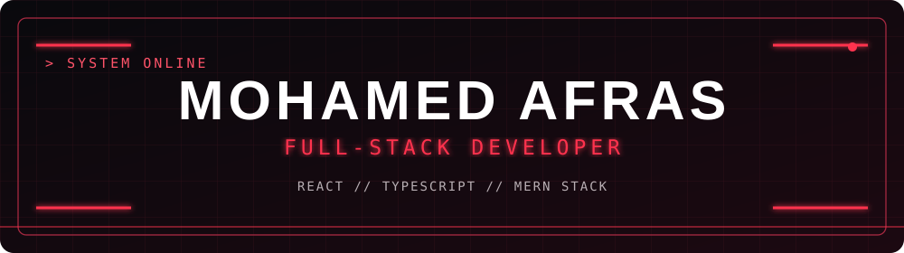
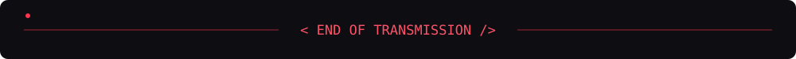

<div align="center">



<br/>


[](https://github.com/afras-am)
[](https://www.linkedin.com/in/afras-am/)

</div>

## `> whoami`

```typescript
const developer = {
  name: 'Mohamed Afras',
  location: 'Sri Lanka',
  focus: ['Full-stack development', 'React', 'MERN stack'],
  currentlyBuilding: 'Modern, practical web applications',
  mindset: 'Learn. Build. Improve. Repeat.'
};
```

I'm a developer focused on creating responsive interfaces and practical full-stack applications. I enjoy transforming ideas into projects, learning new technologies, and improving the experience behind every screen.

## `> tech_stack --list`

<div align="center">


</div>

## `> featured_projects`

| Project | What it does | Repository |
| :--- | :--- | :--- |
| **APEX HORIZON** | Browser-based car racing game built with React, TypeScript and Vite, with custom game mechanics and responsive controls. | [View code](https://github.com/afras-am/Apex-Horizon-Car-Game) |
| **OQURAA CLOUD** | Software-company website project with modern web presentation. | [View code](https://github.com/afras-am/Oquraa-Cloud) |
| **CITY SALON** | Salon website project using PHP and web technologies. | [View code](https://github.com/afras-am/City-salon-website) |
| **OQURAA COMPUTER** | Computer catalog and management website work; ongoing development. | [View repositories](https://github.com/afras-am?tab=repositories&q=oQuraa) |

## `> github_analytics`

<div align="center">


</div>

> **SYSTEM MESSAGE:** Keep learning. Keep shipping. Keep evolving.

<div align="center">
  
</div>
